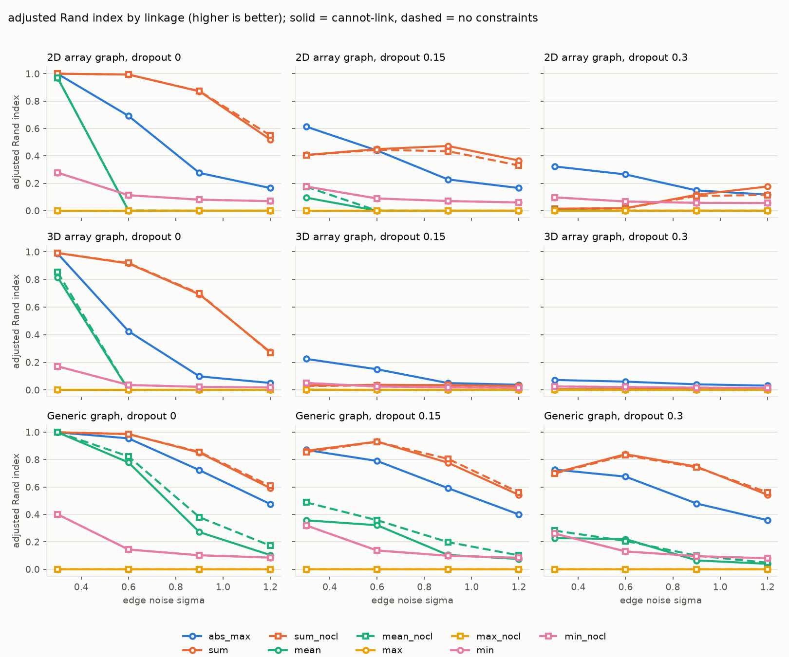
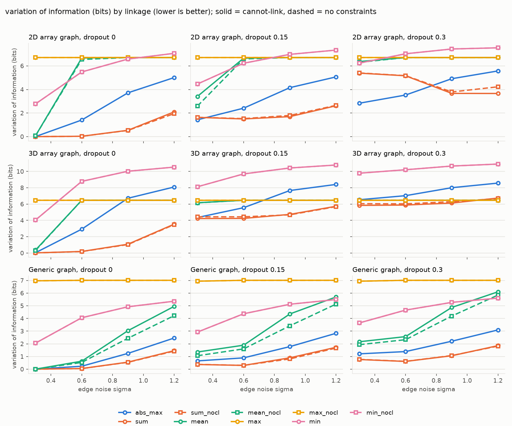
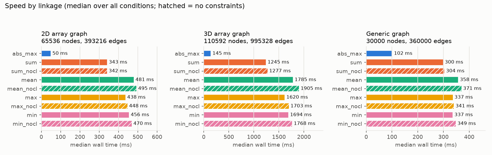

# Linkage accuracy and speed evaluation

Synthetic ground truth segmentations with Gaussian edge noise (`sigma`, applied to a +-1 signal; longer range edges get proportionally more noise) and boundary dropout (`dropout`, fraction of the volume covered by patches where boundary edges are flipped to attractive). Metrics are averaged over seeds. ARI: adjusted Rand index (1 = perfect). VOI: variation of information in bits (0 = perfect), split + merge. `_nocl` variants run without cannot-link constraints. Times are wall clock for one call from Python.

Configuration: `{"out": "examples/linkage_eval", "seeds": 2, "sigmas": [0.3, 0.6, 0.9, 1.2], "dropouts": [0.0, 0.15, 0.3], "size_2d": 256, "cells_2d": 120, "size_3d": 48, "cells_3d": 100, "generic_nodes": 30000, "generic_clusters": 150, "skip": []}`

## Findings

Every number below is averaged over two random seeds; the full tables follow the figures.
The engine was cross-checked against a naive Python reference implementation of GASP
(`tests/test_gasp_reference.py`, 40 random multigraphs per linkage and constraint mode), so the
behaviour of each linkage is a property of the algorithm, not of the implementation.

**Sum linkage is the most accurate under independent edge noise, in every graph family.**
It accumulates evidence over all edges between two clusters, so a few flipped edges are
outvoted. `abs_max` follows the single strongest edge, so one strong flipped edge causes an
error, and it over-segments as noise grows (2D, sigma 0.6: 656 segments for 120 true ones).

| family | sigma | sum ARI | abs_max ARI | sum VOI | abs_max VOI |
|--------|------:|--------:|------------:|--------:|------------:|
| 2D array | 0.9 | 0.87 | 0.28 | 0.5 | 3.7 |
| 3D array | 0.6 | 0.92 | 0.43 | 0.2 | 2.9 |
| generic | 0.9 | 0.85 | 0.72 | 0.5 | 1.2 |

Cannot-link constraints barely matter for `sum`: with and without constraints agree to within
a few hundredths of ARI everywhere, so for this linkage the single-loop variant is as good.

**`abs_max` is more robust to correlated boundary gaps at low noise.** With boundary dropout
(contiguous patches where every boundary edge looks attractive) the strongest edge between two
cells is still very likely one of the many remaining strongly repulsive boundary edges, which
becomes a mutex before the gap edges are reached. `sum` instead counts: once a gap covers
enough of the shared boundary, the two cells merge. At sigma 0.3 and 15% dropout in 2D the ARI
is 0.61 for `abs_max` versus 0.41 for `sum`, with `sum` losing on merge errors (VOI merge 1.5
versus 0.9 bits) while splitting less. As independent noise rises the ordering flips back in
favour of `sum`. In 3D the dropout balls bridge almost every cell pair, so every linkage
collapses (ARI below 0.25) and those columns mostly measure how merge cascades propagate.

**Mean (average) linkage collapses on array graphs once more than about 1% of edges flip
sign.** At sigma 0.6 and above it returns a handful of segments (VOI merge 6.7 bits, the
entropy of the ground truth). The mean ignores how many edges support an interaction, so a
single noisy +2 edge between two voxels outranks a consensus of many +1 edges and is merged
first; the resulting mixed cluster has a near-zero mean interaction with both cells and
spreads along the boundary. On the generic graph, where every node has twelve edges of three
kinds, the degradation is gradual but `mean` still trails `abs_max` by 0.3 to 0.5 ARI. This
differs from the GASP paper, where average linkage was strongest on CREMI; there the
predictions are spatially smooth CNN outputs rather than independently flipped edges, and
that is the regime in which the mean's shift invariance helps rather than hurts.

**Max (single linkage) merges everything** as soon as any boundary carries one positive edge,
so it only works at the lowest noise level on the generic graph. **Min (complete linkage)
over-segments heavily** because one repulsive edge inside a segment blocks the merge, and
the number of segments grows four to ten fold with noise.

**Speed.** `abs_max` runs on its dedicated sorted-edge path; the other linkages pay for
per-cluster adjacency maps and a priority queue. Medians over all conditions, from Python:

| family | nodes | edges | abs_max | sum | mean | max | min |
|--------|------:|------:|--------:|----:|-----:|----:|----:|
| 2D array 256x256 | 65k | 393k | 50 ms | 343 ms | 481 ms | 438 ms | 456 ms |
| 3D array 48x48x48 | 111k | 995k | 145 ms | 1245 ms | 1785 ms | 1620 ms | 1694 ms |
| generic | 30k | 360k | 102 ms | 300 ms | 358 ms | 337 ms | 337 ms |

Generic graph times include converting the Python edge list, which is the same for every
linkage. Noise level and constraints change the times by less than 10%.

**Recommendation.** Keep `abs_max` as the fast default. Use `sum` (either constraint mode)
when edge errors are roughly independent and several edge types vote on the same pair, which
is where it gained 0.1 to 0.6 ARI over `abs_max`. Avoid `mean` and `max` on affinity graphs
with independent noise; use `min` only when a deliberately conservative over-segmentation is
wanted.

## Figures

## 2D array graph

65536 nodes, 393216 edges, shape 256x256, offsets 1/2/4 per axis, 120 ground truth segments.

### Best variant per condition

| sigma | dropout | best ARI | ARI | abs_max ARI | best VOI | VOI | abs_max VOI |
|------:|--------:|----------|----:|------------:|----------|----:|------------:|
| 0.3 | 0.0 | sum | 1.000 | 0.999 | sum | 0.000 | 0.005 |
| 0.3 | 0.15 | abs_max | 0.614 | 0.614 | abs_max | 1.427 | 1.427 |
| 0.3 | 0.3 | abs_max | 0.323 | 0.323 | abs_max | 2.834 | 2.834 |
| 0.6 | 0.0 | sum_nocl | 0.994 | 0.692 | sum_nocl | 0.030 | 1.408 |
| 0.6 | 0.15 | sum | 0.450 | 0.440 | sum | 1.499 | 2.414 |
| 0.6 | 0.3 | abs_max | 0.265 | 0.265 | abs_max | 3.527 | 3.527 |
| 0.9 | 0.0 | sum_nocl | 0.873 | 0.276 | sum_nocl | 0.523 | 3.716 |
| 0.9 | 0.15 | sum | 0.472 | 0.228 | sum | 1.697 | 4.154 |
| 0.9 | 0.3 | abs_max | 0.148 | 0.148 | sum | 3.668 | 4.912 |
| 1.2 | 0.0 | sum_nocl | 0.550 | 0.165 | sum_nocl | 1.952 | 5.008 |
| 1.2 | 0.15 | sum | 0.366 | 0.166 | sum | 2.619 | 5.066 |
| 1.2 | 0.3 | sum | 0.177 | 0.118 | sum | 3.660 | 5.572 |

### ARI by variant

| sigma | dropout | abs_max | sum | sum_nocl | mean | mean_nocl | max | max_nocl | min | min_nocl |
|------:|--------:|----:|----:|----:|----:|----:|----:|----:|----:|----:|
| 0.3 | 0.0 | 0.999 | 1.000 | 1.000 | 0.970 | 0.970 | 0.000 | 0.000 | 0.278 | 0.278 |
| 0.3 | 0.15 | 0.614 | 0.407 | 0.406 | 0.095 | 0.175 | -0.000 | -0.000 | 0.176 | 0.176 |
| 0.3 | 0.3 | 0.323 | 0.014 | 0.014 | 0.002 | 0.002 | 0.000 | 0.000 | 0.097 | 0.097 |
| 0.6 | 0.0 | 0.692 | 0.994 | 0.994 | 0.000 | 0.001 | 0.000 | 0.000 | 0.113 | 0.113 |
| 0.6 | 0.15 | 0.440 | 0.450 | 0.444 | 0.000 | 0.001 | 0.000 | 0.000 | 0.090 | 0.090 |
| 0.6 | 0.3 | 0.265 | 0.018 | 0.018 | 0.000 | 0.000 | 0.000 | 0.000 | 0.067 | 0.067 |
| 0.9 | 0.0 | 0.276 | 0.871 | 0.873 | 0.000 | 0.000 | 0.000 | 0.000 | 0.080 | 0.080 |
| 0.9 | 0.15 | 0.228 | 0.472 | 0.434 | 0.000 | 0.000 | 0.000 | 0.000 | 0.070 | 0.070 |
| 0.9 | 0.3 | 0.148 | 0.116 | 0.107 | 0.000 | 0.000 | 0.000 | 0.000 | 0.057 | 0.057 |
| 1.2 | 0.0 | 0.165 | 0.520 | 0.550 | 0.000 | 0.000 | 0.000 | 0.000 | 0.070 | 0.070 |
| 1.2 | 0.15 | 0.166 | 0.366 | 0.331 | 0.000 | 0.000 | 0.000 | 0.000 | 0.060 | 0.060 |
| 1.2 | 0.3 | 0.118 | 0.177 | 0.115 | 0.000 | 0.000 | 0.000 | 0.000 | 0.056 | 0.056 |

### VOI (split / merge) by variant

| sigma | dropout | abs_max | sum | sum_nocl | mean | mean_nocl | max | max_nocl | min | min_nocl |
|------:|--------:|----:|----:|----:|----:|----:|----:|----:|----:|----:|
| 0.3 | 0.0 | 0.00 / 0.00 | 0.00 / 0.00 | 0.00 / 0.00 | 0.00 / 0.07 | 0.00 / 0.07 | 0.00 / 6.71 | 0.00 / 6.71 | 2.54 / 0.24 | 2.54 / 0.24 |
| 0.3 | 0.15 | 0.50 / 0.93 | 0.09 / 1.54 | 0.09 / 1.55 | 0.01 / 3.40 | 0.02 / 2.57 | 0.00 / 6.71 | 0.00 / 6.71 | 2.99 / 1.47 | 2.99 / 1.47 |
| 0.3 | 0.3 | 0.81 / 2.02 | 0.22 / 5.17 | 0.21 / 5.19 | 0.01 / 6.36 | 0.01 / 6.29 | 0.00 / 6.71 | 0.00 / 6.71 | 3.34 / 2.90 | 3.34 / 2.90 |
| 0.6 | 0.0 | 0.98 / 0.43 | 0.01 / 0.02 | 0.01 / 0.02 | 0.01 / 6.66 | 0.03 / 6.51 | 0.00 / 6.71 | 0.00 / 6.71 | 3.57 / 1.92 | 3.57 / 1.92 |
| 0.6 | 0.15 | 1.11 / 1.30 | 0.12 / 1.38 | 0.12 / 1.41 | 0.01 / 6.65 | 0.03 / 6.56 | 0.00 / 6.71 | 0.00 / 6.71 | 3.67 / 2.56 | 3.67 / 2.56 |
| 0.6 | 0.3 | 1.30 / 2.22 | 0.29 / 4.87 | 0.28 / 4.89 | 0.00 / 6.71 | 0.02 / 6.69 | 0.00 / 6.71 | 0.00 / 6.71 | 3.79 / 3.24 | 3.79 / 3.24 |
| 0.9 | 0.0 | 1.92 / 1.79 | 0.22 / 0.32 | 0.22 / 0.31 | 0.01 / 6.70 | 0.04 / 6.67 | 0.00 / 6.71 | 0.00 / 6.71 | 3.93 / 2.65 | 3.93 / 2.65 |
| 0.9 | 0.15 | 1.96 / 2.19 | 0.33 / 1.37 | 0.32 / 1.47 | 0.01 / 6.70 | 0.04 / 6.67 | 0.00 / 6.71 | 0.00 / 6.71 | 3.99 / 2.99 | 3.99 / 2.99 |
| 0.9 | 0.3 | 2.01 / 2.90 | 0.45 / 3.22 | 0.43 / 3.36 | 0.00 / 6.70 | 0.02 / 6.69 | 0.00 / 6.71 | 0.00 / 6.71 | 4.02 / 3.41 | 4.02 / 3.41 |
| 1.2 | 0.0 | 2.45 / 2.56 | 0.87 / 1.22 | 0.83 / 1.13 | 0.01 / 6.70 | 0.03 / 6.69 | 0.00 / 6.71 | 0.00 / 6.71 | 4.11 / 2.96 | 4.11 / 2.96 |
| 1.2 | 0.15 | 2.40 / 2.67 | 0.85 / 1.77 | 0.82 / 1.83 | 0.01 / 6.70 | 0.05 / 6.66 | 0.00 / 6.71 | 0.00 / 6.71 | 4.14 / 3.20 | 4.14 / 3.20 |
| 1.2 | 0.3 | 2.39 / 3.18 | 0.92 / 2.74 | 0.87 / 3.35 | 0.01 / 6.70 | 0.03 / 6.69 | 0.00 / 6.71 | 0.00 / 6.71 | 4.16 / 3.37 | 4.16 / 3.37 |

### Segments by variant (ground truth in parentheses)

| sigma | dropout | abs_max | sum | sum_nocl | mean | mean_nocl | max | max_nocl | min | min_nocl |
|------:|--------:|----:|----:|----:|----:|----:|----:|----:|----:|----:|
| 0.3 | 0.0 (120) | 126 | 122 | 122 | 118 | 118 | 1 | 1 | 584 | 584 |
| 0.3 | 0.15 (120) | 214 | 200 | 278 | 42 | 64 | 2 | 2 | 402 | 402 |
| 0.3 | 0.3 (120) | 274 | 358 | 487 | 12 | 38 | 2 | 2 | 226 | 226 |
| 0.6 | 0.0 (120) | 656 | 160 | 160 | 12 | 81 | 2 | 2 | 562 | 562 |
| 0.6 | 0.15 (120) | 562 | 274 | 326 | 11 | 86 | 1 | 1 | 434 | 434 |
| 0.6 | 0.3 (120) | 520 | 492 | 609 | 6 | 77 | 1 | 1 | 324 | 324 |
| 0.9 | 0.0 (120) | 696 | 704 | 748 | 21 | 120 | 2 | 2 | 592 | 592 |
| 0.9 | 0.15 (120) | 675 | 757 | 862 | 20 | 112 | 1 | 1 | 504 | 504 |
| 0.9 | 0.3 (120) | 604 | 803 | 954 | 18 | 104 | 1 | 1 | 420 | 420 |
| 1.2 | 0.0 (120) | 852 | 1552 | 1866 | 46 | 102 | 2 | 2 | 662 | 662 |
| 1.2 | 0.15 (120) | 782 | 1498 | 1843 | 44 | 118 | 1 | 1 | 612 | 612 |
| 1.2 | 0.3 (120) | 734 | 1470 | 1860 | 34 | 108 | 2 | 2 | 553 | 553 |

### Time in ms by variant

| sigma | dropout | abs_max | sum | sum_nocl | mean | mean_nocl | max | max_nocl | min | min_nocl |
|------:|--------:|----:|----:|----:|----:|----:|----:|----:|----:|----:|
| 0.3 | 0.0 | 54 | 340 | 323 | 529 | 533 | 485 | 492 | 499 | 506 |
| 0.3 | 0.15 | 48 | 316 | 320 | 507 | 515 | 455 | 463 | 478 | 487 |
| 0.3 | 0.3 | 48 | 317 | 320 | 489 | 496 | 442 | 449 | 464 | 475 |
| 0.6 | 0.0 | 50 | 327 | 333 | 487 | 498 | 439 | 450 | 459 | 472 |
| 0.6 | 0.15 | 46 | 325 | 328 | 482 | 491 | 436 | 446 | 456 | 469 |
| 0.6 | 0.3 | 45 | 325 | 328 | 481 | 493 | 438 | 447 | 457 | 469 |
| 0.9 | 0.0 | 53 | 361 | 369 | 479 | 498 | 438 | 450 | 454 | 471 |
| 0.9 | 0.15 | 49 | 343 | 349 | 475 | 491 | 432 | 446 | 454 | 469 |
| 0.9 | 0.3 | 48 | 344 | 349 | 476 | 492 | 436 | 446 | 451 | 470 |
| 1.2 | 0.0 | 55 | 369 | 377 | 475 | 497 | 435 | 450 | 449 | 470 |
| 1.2 | 0.15 | 51 | 363 | 371 | 474 | 494 | 433 | 447 | 445 | 466 |
| 1.2 | 0.3 | 54 | 367 | 375 | 478 | 498 | 438 | 451 | 450 | 469 |

## 3D array graph

110592 nodes, 995328 edges, shape 48x48x48, offsets 1/2/4 per axis, 100 ground truth segments.

### Best variant per condition

| sigma | dropout | best ARI | ARI | abs_max ARI | best VOI | VOI | abs_max VOI |
|------:|--------:|----------|----:|------------:|----------|----:|------------:|
| 0.3 | 0.0 | sum | 0.991 | 0.988 | sum | 0.020 | 0.038 |
| 0.3 | 0.15 | abs_max | 0.225 | 0.225 | sum | 4.230 | 4.351 |
| 0.3 | 0.3 | abs_max | 0.073 | 0.073 | sum | 5.839 | 6.531 |
| 0.6 | 0.0 | sum_nocl | 0.919 | 0.425 | sum_nocl | 0.180 | 2.925 |
| 0.6 | 0.15 | abs_max | 0.150 | 0.150 | sum | 4.246 | 5.557 |
| 0.6 | 0.3 | abs_max | 0.061 | 0.061 | sum | 5.881 | 7.029 |
| 0.9 | 0.0 | sum_nocl | 0.698 | 0.098 | sum_nocl | 1.040 | 6.713 |
| 0.9 | 0.15 | abs_max | 0.050 | 0.050 | sum_nocl | 4.683 | 7.660 |
| 0.9 | 0.3 | abs_max | 0.041 | 0.041 | sum | 6.127 | 8.006 |
| 1.2 | 0.0 | sum | 0.275 | 0.051 | sum_nocl | 3.483 | 8.093 |
| 1.2 | 0.15 | abs_max | 0.038 | 0.038 | sum_nocl | 5.683 | 8.407 |
| 1.2 | 0.3 | abs_max | 0.031 | 0.031 | max | 6.464 | 8.570 |

### ARI by variant

| sigma | dropout | abs_max | sum | sum_nocl | mean | mean_nocl | max | max_nocl | min | min_nocl |
|------:|--------:|----:|----:|----:|----:|----:|----:|----:|----:|----:|
| 0.3 | 0.0 | 0.988 | 0.991 | 0.991 | 0.817 | 0.852 | 0.000 | 0.000 | 0.171 | 0.171 |
| 0.3 | 0.15 | 0.225 | 0.032 | 0.029 | 0.002 | 0.002 | 0.000 | 0.000 | 0.051 | 0.051 |
| 0.3 | 0.3 | 0.073 | 0.005 | 0.004 | 0.000 | 0.000 | 0.000 | 0.000 | 0.026 | 0.026 |
| 0.6 | 0.0 | 0.425 | 0.916 | 0.919 | 0.000 | 0.000 | 0.000 | 0.000 | 0.036 | 0.036 |
| 0.6 | 0.15 | 0.150 | 0.037 | 0.033 | 0.000 | 0.000 | 0.000 | 0.000 | 0.025 | 0.025 |
| 0.6 | 0.3 | 0.061 | 0.006 | 0.005 | -0.000 | 0.000 | 0.000 | 0.000 | 0.021 | 0.021 |
| 0.9 | 0.0 | 0.098 | 0.692 | 0.698 | 0.000 | 0.000 | 0.000 | 0.000 | 0.023 | 0.023 |
| 0.9 | 0.15 | 0.050 | 0.035 | 0.035 | 0.000 | 0.000 | 0.000 | 0.000 | 0.019 | 0.019 |
| 0.9 | 0.3 | 0.041 | 0.006 | 0.005 | 0.000 | 0.000 | 0.000 | 0.000 | 0.017 | 0.017 |
| 1.2 | 0.0 | 0.051 | 0.275 | 0.270 | 0.000 | 0.000 | 0.000 | 0.000 | 0.018 | 0.018 |
| 1.2 | 0.15 | 0.038 | 0.029 | 0.024 | -0.000 | 0.000 | 0.000 | 0.000 | 0.016 | 0.016 |
| 1.2 | 0.3 | 0.031 | 0.005 | 0.004 | 0.000 | 0.000 | 0.000 | 0.000 | 0.015 | 0.015 |

### VOI (split / merge) by variant

| sigma | dropout | abs_max | sum | sum_nocl | mean | mean_nocl | max | max_nocl | min | min_nocl |
|------:|--------:|----:|----:|----:|----:|----:|----:|----:|----:|----:|
| 0.3 | 0.0 | 0.01 / 0.02 | 0.00 / 0.02 | 0.00 / 0.02 | 0.02 / 0.34 | 0.02 / 0.29 | 0.00 / 6.46 | 0.00 / 6.46 | 3.19 / 0.85 | 3.19 / 0.85 |
| 0.3 | 0.15 | 1.58 / 2.77 | 0.40 / 3.83 | 0.42 / 4.02 | 0.00 / 6.16 | 0.00 / 6.15 | 0.00 / 6.46 | 0.00 / 6.46 | 4.44 / 3.68 | 4.44 / 3.68 |
| 0.3 | 0.3 | 2.15 / 4.38 | 0.53 / 5.31 | 0.55 / 5.50 | 0.00 / 6.46 | 0.00 / 6.46 | 0.00 / 6.46 | 0.00 / 6.46 | 4.98 / 4.80 | 4.98 / 4.80 |
| 0.6 | 0.0 | 1.26 / 1.66 | 0.01 / 0.18 | 0.01 / 0.17 | 0.00 / 6.46 | 0.00 / 6.46 | 0.00 / 6.46 | 0.00 / 6.46 | 4.65 / 4.14 | 4.65 / 4.14 |
| 0.6 | 0.15 | 2.06 / 3.49 | 0.47 / 3.78 | 0.47 / 3.97 | 0.00 / 6.46 | 0.00 / 6.46 | 0.00 / 6.46 | 0.00 / 6.46 | 4.96 / 4.74 | 4.96 / 4.74 |
| 0.6 | 0.3 | 2.37 / 4.66 | 0.62 / 5.27 | 0.62 / 5.41 | 0.00 / 6.46 | 0.00 / 6.46 | 0.00 / 6.46 | 0.00 / 6.46 | 5.21 / 5.00 | 5.21 / 5.00 |
| 0.9 | 0.0 | 2.65 / 4.06 | 0.23 / 0.86 | 0.21 / 0.83 | 0.00 / 6.46 | 0.00 / 6.46 | 0.00 / 6.46 | 0.00 / 6.46 | 5.15 / 4.88 | 5.15 / 4.88 |
| 0.9 | 0.15 | 2.80 / 4.86 | 0.76 / 3.98 | 0.69 / 3.99 | 0.00 / 6.46 | 0.00 / 6.46 | 0.00 / 6.46 | 0.00 / 6.46 | 5.30 / 5.12 | 5.30 / 5.12 |
| 0.9 | 0.3 | 2.86 / 5.15 | 0.89 / 5.24 | 0.88 / 5.42 | 0.00 / 6.46 | 0.00 / 6.46 | 0.00 / 6.46 | 0.00 / 6.46 | 5.45 / 5.21 | 5.45 / 5.21 |
| 1.2 | 0.0 | 3.19 / 4.91 | 0.96 / 2.58 | 0.88 / 2.61 | 0.00 / 6.46 | 0.00 / 6.46 | 0.00 / 6.46 | 0.00 / 6.46 | 5.41 / 5.12 | 5.41 / 5.12 |
| 1.2 | 0.15 | 3.28 / 5.13 | 1.25 / 4.48 | 1.17 / 4.52 | 0.00 / 6.46 | 0.00 / 6.46 | 0.00 / 6.46 | 0.00 / 6.46 | 5.50 / 5.28 | 5.50 / 5.28 |
| 1.2 | 0.3 | 3.24 / 5.33 | 1.30 / 5.43 | 1.22 / 5.45 | 0.00 / 6.46 | 0.00 / 6.46 | 0.00 / 6.46 | 0.00 / 6.46 | 5.59 / 5.32 | 5.59 / 5.32 |

### Segments by variant (ground truth in parentheses)

| sigma | dropout | abs_max | sum | sum_nocl | mean | mean_nocl | max | max_nocl | min | min_nocl |
|------:|--------:|----:|----:|----:|----:|----:|----:|----:|----:|----:|
| 0.3 | 0.0 (100) | 110 | 100 | 100 | 88 | 90 | 2 | 2 | 550 | 550 |
| 0.3 | 0.15 (100) | 191 | 402 | 804 | 7 | 16 | 2 | 2 | 226 | 226 |
| 0.3 | 0.3 (100) | 184 | 636 | 1044 | 2 | 8 | 2 | 2 | 120 | 120 |
| 0.6 | 0.0 (100) | 380 | 122 | 123 | 4 | 16 | 1 | 1 | 178 | 178 |
| 0.6 | 0.15 (100) | 232 | 595 | 987 | 3 | 18 | 1 | 1 | 132 | 132 |
| 0.6 | 0.3 (100) | 187 | 923 | 1323 | 2 | 18 | 1 | 1 | 114 | 114 |
| 0.9 | 0.0 (100) | 222 | 518 | 566 | 4 | 14 | 1 | 1 | 132 | 132 |
| 0.9 | 0.15 (100) | 174 | 1125 | 1508 | 2 | 18 | 1 | 1 | 118 | 118 |
| 0.9 | 0.3 (100) | 173 | 1342 | 1808 | 2 | 18 | 1 | 1 | 121 | 121 |
| 1.2 | 0.0 (100) | 179 | 1380 | 1712 | 3 | 6 | 1 | 1 | 132 | 132 |
| 1.2 | 0.15 (100) | 156 | 1612 | 2124 | 4 | 8 | 1 | 1 | 124 | 124 |
| 1.2 | 0.3 (100) | 146 | 1655 | 2210 | 4 | 16 | 1 | 1 | 131 | 131 |

### Time in ms by variant

| sigma | dropout | abs_max | sum | sum_nocl | mean | mean_nocl | max | max_nocl | min | min_nocl |
|------:|--------:|----:|----:|----:|----:|----:|----:|----:|----:|----:|
| 0.3 | 0.0 | 165 | 1112 | 1128 | 1849 | 1903 | 1651 | 1734 | 1790 | 1820 |
| 0.3 | 0.15 | 162 | 1158 | 1196 | 1837 | 1912 | 1648 | 1716 | 1756 | 1815 |
| 0.3 | 0.3 | 163 | 1201 | 1231 | 1821 | 1927 | 1670 | 1724 | 1740 | 1796 |
| 0.6 | 0.0 | 141 | 1148 | 1178 | 1793 | 1897 | 1626 | 1705 | 1717 | 1776 |
| 0.6 | 0.15 | 142 | 1207 | 1245 | 1804 | 1902 | 1629 | 1701 | 1714 | 1771 |
| 0.6 | 0.3 | 140 | 1261 | 1298 | 1788 | 1903 | 1622 | 1698 | 1700 | 1766 |
| 0.9 | 0.0 | 151 | 1229 | 1260 | 1772 | 1908 | 1614 | 1701 | 1671 | 1756 |
| 0.9 | 0.15 | 145 | 1273 | 1315 | 1779 | 1890 | 1607 | 1697 | 1686 | 1755 |
| 0.9 | 0.3 | 144 | 1307 | 1346 | 1784 | 1900 | 1623 | 1698 | 1690 | 1763 |
| 1.2 | 0.0 | 150 | 1312 | 1351 | 1753 | 1901 | 1601 | 1696 | 1664 | 1743 |
| 1.2 | 0.15 | 145 | 1324 | 1377 | 1761 | 1921 | 1604 | 1695 | 1675 | 1766 |
| 1.2 | 0.3 | 142 | 1354 | 1394 | 1759 | 1898 | 1608 | 1701 | 1674 | 1759 |

## Generic graph

30000 nodes, 360000 edges (short: 180000, long: 90000, embedding: 90000), 150 ground truth segments.

### Best variant per condition

| sigma | dropout | best ARI | ARI | abs_max ARI | best VOI | VOI | abs_max VOI |
|------:|--------:|----------|----:|------------:|----------|----:|------------:|
| 0.3 | 0.0 | sum | 0.999 | 0.999 | sum | 0.005 | 0.006 |
| 0.3 | 0.15 | abs_max | 0.871 | 0.871 | sum | 0.371 | 0.653 |
| 0.3 | 0.3 | abs_max | 0.727 | 0.727 | sum | 0.762 | 1.210 |
| 0.6 | 0.0 | sum | 0.986 | 0.955 | sum | 0.050 | 0.233 |
| 0.6 | 0.15 | sum | 0.931 | 0.790 | sum | 0.298 | 0.893 |
| 0.6 | 0.3 | sum | 0.839 | 0.676 | sum | 0.612 | 1.389 |
| 0.9 | 0.0 | sum_nocl | 0.856 | 0.723 | sum_nocl | 0.540 | 1.246 |
| 0.9 | 0.15 | sum_nocl | 0.806 | 0.592 | sum_nocl | 0.810 | 1.779 |
| 0.9 | 0.3 | sum | 0.749 | 0.480 | sum | 1.060 | 2.206 |
| 1.2 | 0.0 | sum_nocl | 0.608 | 0.475 | sum_nocl | 1.425 | 2.458 |
| 1.2 | 0.15 | sum_nocl | 0.561 | 0.400 | sum_nocl | 1.667 | 2.831 |
| 1.2 | 0.3 | sum_nocl | 0.561 | 0.358 | sum_nocl | 1.821 | 3.096 |

### ARI by variant

| sigma | dropout | abs_max | sum | sum_nocl | mean | mean_nocl | max | max_nocl | min | min_nocl |
|------:|--------:|----:|----:|----:|----:|----:|----:|----:|----:|----:|
| 0.3 | 0.0 | 0.999 | 0.999 | 0.999 | 0.999 | 0.999 | 0.000 | 0.000 | 0.401 | 0.401 |
| 0.3 | 0.15 | 0.871 | 0.864 | 0.855 | 0.357 | 0.488 | 0.000 | 0.000 | 0.320 | 0.320 |
| 0.3 | 0.3 | 0.727 | 0.703 | 0.698 | 0.227 | 0.282 | 0.000 | 0.000 | 0.260 | 0.260 |
| 0.6 | 0.0 | 0.955 | 0.986 | 0.986 | 0.779 | 0.823 | -0.000 | -0.000 | 0.144 | 0.144 |
| 0.6 | 0.15 | 0.790 | 0.931 | 0.930 | 0.322 | 0.358 | -0.000 | -0.000 | 0.137 | 0.137 |
| 0.6 | 0.3 | 0.676 | 0.839 | 0.832 | 0.221 | 0.207 | -0.000 | -0.000 | 0.130 | 0.130 |
| 0.9 | 0.0 | 0.723 | 0.851 | 0.856 | 0.271 | 0.380 | 0.000 | 0.000 | 0.102 | 0.102 |
| 0.9 | 0.15 | 0.592 | 0.777 | 0.806 | 0.105 | 0.198 | 0.000 | 0.000 | 0.099 | 0.099 |
| 0.9 | 0.3 | 0.480 | 0.749 | 0.743 | 0.065 | 0.100 | -0.000 | -0.000 | 0.096 | 0.096 |
| 1.2 | 0.0 | 0.475 | 0.592 | 0.608 | 0.104 | 0.172 | 0.000 | 0.000 | 0.085 | 0.085 |
| 1.2 | 0.15 | 0.400 | 0.543 | 0.561 | 0.075 | 0.102 | 0.000 | 0.000 | 0.084 | 0.084 |
| 1.2 | 0.3 | 0.358 | 0.543 | 0.561 | 0.040 | 0.048 | -0.000 | -0.000 | 0.080 | 0.080 |

### VOI (split / merge) by variant

| sigma | dropout | abs_max | sum | sum_nocl | mean | mean_nocl | max | max_nocl | min | min_nocl |
|------:|--------:|----:|----:|----:|----:|----:|----:|----:|----:|----:|
| 0.3 | 0.0 | 0.00 / 0.00 | 0.00 / 0.00 | 0.00 / 0.00 | 0.00 / 0.00 | 0.00 / 0.00 | 0.00 / 6.97 | 0.00 / 6.97 | 1.97 / 0.08 | 1.97 / 0.08 |
| 0.3 | 0.15 | 0.37 / 0.28 | 0.06 / 0.31 | 0.05 / 0.33 | 0.04 / 1.31 | 0.05 / 1.01 | 0.00 / 6.94 | 0.00 / 6.94 | 2.35 / 0.58 | 2.35 / 0.58 |
| 0.3 | 0.3 | 0.57 / 0.64 | 0.10 / 0.67 | 0.09 / 0.69 | 0.05 / 2.12 | 0.06 / 1.88 | 0.00 / 6.94 | 0.00 / 6.94 | 2.63 / 1.02 | 2.63 / 1.02 |
| 0.6 | 0.0 | 0.20 / 0.03 | 0.05 / 0.00 | 0.05 / 0.00 | 0.11 / 0.52 | 0.11 / 0.42 | 0.00 / 7.01 | 0.00 / 7.01 | 3.59 / 0.47 | 3.59 / 0.47 |
| 0.6 | 0.15 | 0.48 / 0.41 | 0.12 / 0.18 | 0.13 / 0.18 | 0.17 / 1.72 | 0.17 / 1.44 | 0.00 / 7.01 | 0.00 / 7.01 | 3.65 / 0.73 | 3.65 / 0.73 |
| 0.6 | 0.3 | 0.62 / 0.76 | 0.19 / 0.42 | 0.18 / 0.43 | 0.15 / 2.42 | 0.19 / 2.13 | 0.00 / 7.01 | 0.00 / 7.01 | 3.70 / 0.96 | 3.70 / 0.96 |
| 0.9 | 0.0 | 0.94 / 0.31 | 0.54 / 0.02 | 0.53 / 0.01 | 0.64 / 2.40 | 0.60 / 1.84 | 0.00 / 7.01 | 0.00 / 7.01 | 4.13 / 0.79 | 4.13 / 0.79 |
| 0.9 | 0.15 | 1.05 / 0.73 | 0.71 / 0.18 | 0.66 / 0.15 | 0.69 / 3.67 | 0.68 / 2.74 | 0.00 / 7.01 | 0.00 / 7.01 | 4.17 / 0.95 | 4.17 / 0.95 |
| 0.9 | 0.3 | 1.11 / 1.10 | 0.75 / 0.31 | 0.76 / 0.32 | 0.66 / 4.22 | 0.66 / 3.53 | 0.00 / 7.01 | 0.00 / 7.01 | 4.20 / 1.07 | 4.20 / 1.07 |
| 1.2 | 0.0 | 1.64 / 0.82 | 1.41 / 0.05 | 1.39 / 0.04 | 1.21 / 3.74 | 1.16 / 3.06 | 0.00 / 7.01 | 0.00 / 7.01 | 4.43 / 0.93 | 4.43 / 0.93 |
| 1.2 | 0.15 | 1.65 / 1.18 | 1.53 / 0.19 | 1.49 / 0.18 | 1.30 / 4.39 | 1.24 / 3.90 | 0.00 / 7.01 | 0.00 / 7.01 | 4.45 / 1.05 | 4.45 / 1.05 |
| 1.2 | 0.3 | 1.68 / 1.41 | 1.54 / 0.32 | 1.50 / 0.32 | 1.17 / 4.93 | 1.18 / 4.67 | 0.00 / 7.01 | 0.00 / 7.01 | 4.48 / 1.12 | 4.48 / 1.12 |

### Segments by variant (ground truth in parentheses)

| sigma | dropout | abs_max | sum | sum_nocl | mean | mean_nocl | max | max_nocl | min | min_nocl |
|------:|--------:|----:|----:|----:|----:|----:|----:|----:|----:|----:|
| 0.3 | 0.0 (150) | 153 | 152 | 152 | 152 | 152 | 4 | 4 | 569 | 569 |
| 0.3 | 0.15 (150) | 212 | 146 | 148 | 100 | 108 | 4 | 4 | 540 | 540 |
| 0.3 | 0.3 (150) | 236 | 136 | 140 | 70 | 79 | 4 | 4 | 496 | 496 |
| 0.6 | 0.0 (150) | 293 | 170 | 170 | 134 | 142 | 2 | 2 | 1480 | 1480 |
| 0.6 | 0.15 (150) | 338 | 170 | 173 | 90 | 114 | 2 | 2 | 1338 | 1338 |
| 0.6 | 0.3 (150) | 344 | 164 | 167 | 68 | 94 | 2 | 2 | 1222 | 1222 |
| 0.9 | 0.0 (150) | 660 | 350 | 366 | 108 | 160 | 1 | 1 | 1978 | 1978 |
| 0.9 | 0.15 (150) | 646 | 346 | 365 | 78 | 134 | 1 | 1 | 1868 | 1868 |
| 0.9 | 0.3 (150) | 608 | 330 | 352 | 63 | 110 | 2 | 2 | 1782 | 1782 |
| 1.2 | 0.0 (150) | 849 | 704 | 736 | 124 | 200 | 2 | 2 | 2349 | 2349 |
| 1.2 | 0.15 (150) | 809 | 685 | 720 | 95 | 166 | 1 | 1 | 2232 | 2232 |
| 1.2 | 0.3 (150) | 782 | 628 | 672 | 84 | 145 | 2 | 2 | 2180 | 2180 |

### Time in ms by variant

| sigma | dropout | abs_max | sum | sum_nocl | mean | mean_nocl | max | max_nocl | min | min_nocl |
|------:|--------:|----:|----:|----:|----:|----:|----:|----:|----:|----:|
| 0.3 | 0.0 | 118 | 301 | 305 | 380 | 392 | 354 | 363 | 364 | 375 |
| 0.3 | 0.15 | 113 | 296 | 300 | 369 | 377 | 344 | 350 | 350 | 360 |
| 0.3 | 0.3 | 112 | 295 | 298 | 369 | 378 | 341 | 348 | 348 | 358 |
| 0.6 | 0.0 | 102 | 296 | 298 | 359 | 369 | 335 | 339 | 338 | 349 |
| 0.6 | 0.15 | 100 | 292 | 296 | 357 | 367 | 335 | 339 | 338 | 350 |
| 0.6 | 0.3 | 100 | 292 | 297 | 358 | 368 | 336 | 341 | 339 | 350 |
| 0.9 | 0.0 | 101 | 299 | 310 | 358 | 372 | 336 | 341 | 335 | 347 |
| 0.9 | 0.15 | 101 | 301 | 305 | 355 | 371 | 338 | 342 | 335 | 348 |
| 0.9 | 0.3 | 102 | 301 | 307 | 357 | 370 | 342 | 342 | 339 | 349 |
| 1.2 | 0.0 | 103 | 307 | 313 | 356 | 371 | 337 | 341 | 333 | 347 |
| 1.2 | 0.15 | 103 | 308 | 315 | 359 | 370 | 338 | 342 | 335 | 347 |
| 1.2 | 0.3 | 103 | 308 | 314 | 356 | 371 | 336 | 342 | 336 | 348 |
